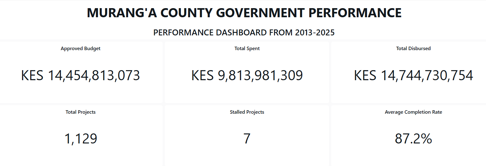
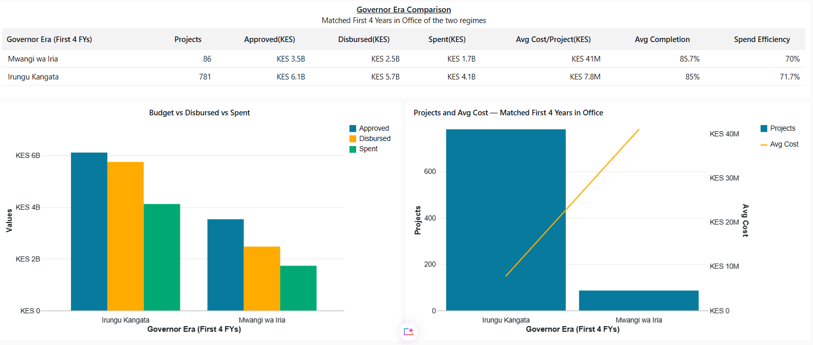

# 📊 Murang'a County Projects Performance Dashboard

This dashboard evaluates a fundamental question regarding local governance: **How well does a county government deliver on its project pipeline — and can the performance of two different administrations be compared objectively?**

Using data covering every county project in Murang'a, Kenya, from **FY 2013/14 to 2025/26**, this platform tracks budgets, disbursements, actual spending, and completion rates. It breaks down the data geographically by ward and sub-county, and temporally across different political eras to provide a data-driven look at local devolution.

---

## 📸 Dashboard Preview

*Figure 1: Main Executive View showcasing high-level KPIs, spending efficiency, and the active At-Risk Watchlist.*

*Figure 2: Matched-timeline comparison evaluating performance metrics across administrations.*

---

## 🎯 What the Dashboard Solves

Instead of forcing stakeholders to sift through massive, disparate public sector spreadsheets, this platform synthesizes complex financial reports into actionable views:

*   **Executive KPIs:** High-level tracking of total projects, approved vs. disbursed funds, actual spend, stalled projects, and average completion rates.
*   **The Money Trail:** Financial flows visualized by fiscal year, sector, and governor era.
*   **Sector Deep-Dives:** Built-in trend panels normalized per sector so massive portfolios (like Agriculture) do not visually dwarf smaller, critical sectors.
*   **Geographical Mapping:** Project delivery and resource distribution mapped down to the sub-county and ward levels.
*   **Development Partner Tracking:** A fair-split allocation model for projects co-funded by external development partners.
*   **At-Risk Watchlist:** A dedicated, actionable view targeting stalled or low-completion projects.
*   **The Governor Comparison Panel:** A strict **matched-timeline comparison** evaluating each administration’s performance based solely on their respective first 4 fiscal years.

---

## 💡 Key Data Insights

By normalizing the data and matching timelines, several objective realities emerge from Murang'a's devolution history:

*   **Scale vs. Volume:** On matched timelines, the two eras tell completely opposite operational stories. Mwangi wa Iria’s first 4 years focused on **86 large-scale projects** (averaging ~KES 41M each). Conversely, Irungu Kang'ata’s first 4 years pivoted toward community-level volume, delivering **781 smaller projects** (averaging ~KES 7.8M each)—a 9x increase in project count at a fifth of the budget size per project.
*   **Identical Delivery Quality:** Despite radically different strategies (fewer mega-projects vs. hundreds of hyper-local ones), project quality remained nearly identical: both administrations hit a **~85% average completion rate** and **~70% spend efficiency**.
*   **The Spending Blindspots:** While Agriculture dominates county spending, sectors like Trade, Irrigation, and Environment show approved budgets but *zero* recorded spend—highlighting a critical data gap or systemic implementation bottleneck worth investigating.
*   **The Watchlist:** The dashboard successfully isolated **29 projects** that are genuinely at risk or stalled, stripping away administrative noise.

---

## 🛠️ Architecture & Tech Stack

This project is built natively within the **Databricks** ecosystem to ensure scalability and governance. Responsibilities are divided across three key layers:

[Unity Catalog] ──> [Metric-View Definitions] ──> [Databricks AI/BI Dashboard]
(Secure Data)           (SQL Repo Source)              (Interactive Layer)

*   **Data Layer `[Unity Catalog]`**: Serves as the secure storage layer for raw datasets (`projects.muranga.projects`) and geographic views. For data governance and privacy, the raw data remains securely in the catalog and is not committed to Git.
*   **Pipeline Layer `[Bronze → Silver → Gold]`**: The ETL notebook [`Murang'a CG Projects Bronze to Silver to Gold.ipynb`](Murang'a%20CG%20Projects%20Bronze%20to%20Silver%20to%20Gold%20.ipynb) cleans the raw county project records and lands them as governed Delta tables in Unity Catalog — the tables every metric view above reads from.
*   **Transformation Layer `[Metric-View Definitions]`**: The business logic, data cleaning, timeline-matching calculations, and fair-split financial models — versioned in this repository under [`datasets/`](datasets/):
    *   [`projects_perf.yaml`](datasets/projects_perf.yaml) — the core portfolio dataset: status normalization (100%-complete projects counted as Completed), full and matched-timeline governor eras, the at-risk watchlist flag, and all ratio measures (spend efficiency, avg cost/spend per project).
    *   [`ward_perf.yaml`](datasets/ward_perf.yaml) and [`subcounty_perf.yaml`](datasets/subcounty_perf.yaml) — geography datasets where each project's money is split across every ward/sub-county it touches, so regional sums never double-count.
    *   [`partner_perf.yaml`](datasets/partner_perf.yaml) — development partners exploded one row per partner, each credited a fair 1/N share of a project's approved, disbursed, and spent amounts.
*   **Presentation Layer `[Databricks AI/BI Dashboard]`**: The frontend presentation layer that reads from the metric views to display interactive charts, trend panels, and geographical maps.

### 📝 An Honest Caveat on the Data
Devolution is transitionary. FY 2013/14 was budgeted during Kenya's initial transition to the devolved system. Because of this, a small sliver of Wa Iria's "first 4 years" data reflects a transitionary budget that predates his administration's absolute operational control.

[The final dashboard](docs/dashboard.pdf): NOTE; This is a pdf format, just showing the dashboard components.
